# ☕ Cha-Wala on Kubernetes

Deploying **Rahim Mama's Cha** online menu on Kubernetes (kind), with ConfigMaps, Secrets, rolling updates, rollbacks and a debugging challenge.

> **Note:** All passwords and API keys in this repo are **dummy values**. No real credentials are committed.

## Contents

- [Repository Structure](#repository-structure)
- [Prerequisites](#prerequisites)
- [Task 1: Cluster & Namespace](#task-1-cluster--namespace)
- [Task 2: ConfigMap](#task-2-configmap)
- [Task 3: Secret](#task-3-secret)
- [Task 4: Deployment & Service](#task-4-deployment--service)
- [Task 5: GitHub Copilot](#task-5-github-copilot)
- [Task 6: Rolling Update & Rollback](#task-6-rolling-update--rollback)
- [Task 7: Debug Challenge](#task-7-debug-challenge-the-shop-is-closed)
- [Bonus: ConfigMap Updates](#bonus-configmap-updates)

## Repository Structure

```
cha-wala/
├── kind-config.yaml
├── manifests/
│   ├── 00-namespace.yaml
│   ├── 01-configmap.yaml
│   ├── 02-secret.yaml          # dummy values only
│   ├── 03-deployment.yaml
│   ├── 04-service.yaml
│   └── broken/
│       ├── cha-broken.yaml     # original (buggy)
│       └── cha-fixed.yaml      # corrected
├── screenshots/
└── README.md
```

## Prerequisites

- Docker, `kubectl`, `kind`

---

## Task 1: Cluster & Namespace

I used **kind** with 1 control-plane and 2 worker nodes. An `extraPortMappings` entry maps NodePort `30080` to the host so the app is reachable at `http://localhost:30080`.

```bash
kind create cluster --name cha --config kind-config.yaml
kubectl cluster-info --context kind-cha
kubectl get nodes -o wide
kubectl create namespace cha-express
kubectl get ns
kubectl get pods -n kube-system -o wide
```

**Node information:**

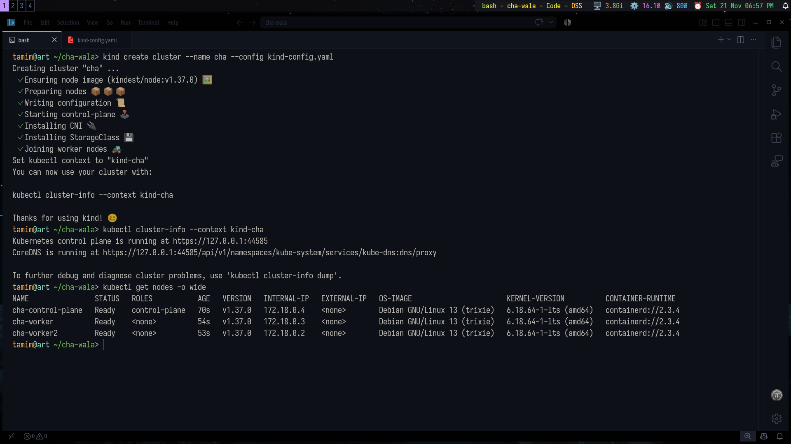

**Namespace:**

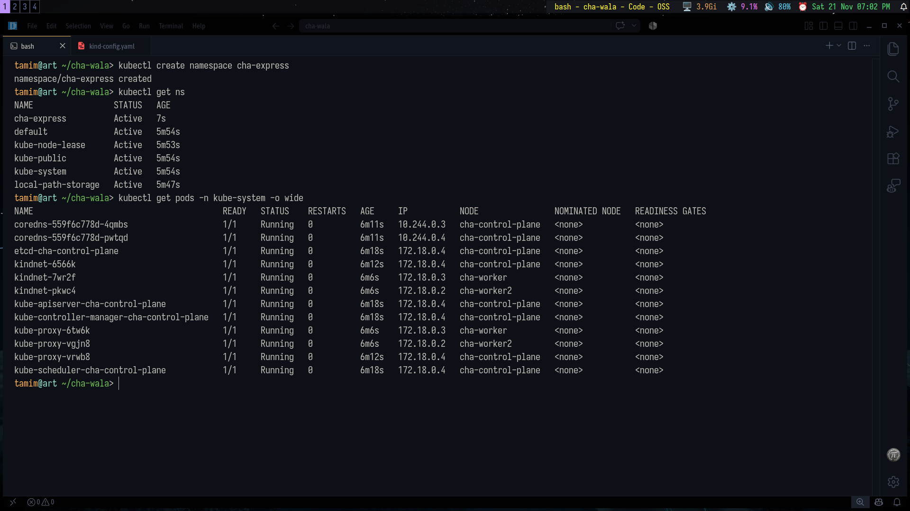

### Control plane components

| Component | Role |
|-----------|------|
| `kube-apiserver` | Front door of the cluster; all `kubectl` and component traffic goes through it |
| `etcd` | Key-value store holding all cluster state |
| `kube-scheduler` | Assigns new pods to nodes |
| `kube-controller-manager` | Runs controllers (Deployment, ReplicaSet, Node, etc.) that reconcile desired vs actual state |

Other components in `kube-system`: `kube-proxy` (Service networking on each node), `coredns` (cluster DNS), `kindnet` (CNI for kind). The control plane components run as **static pods** on the control-plane node.

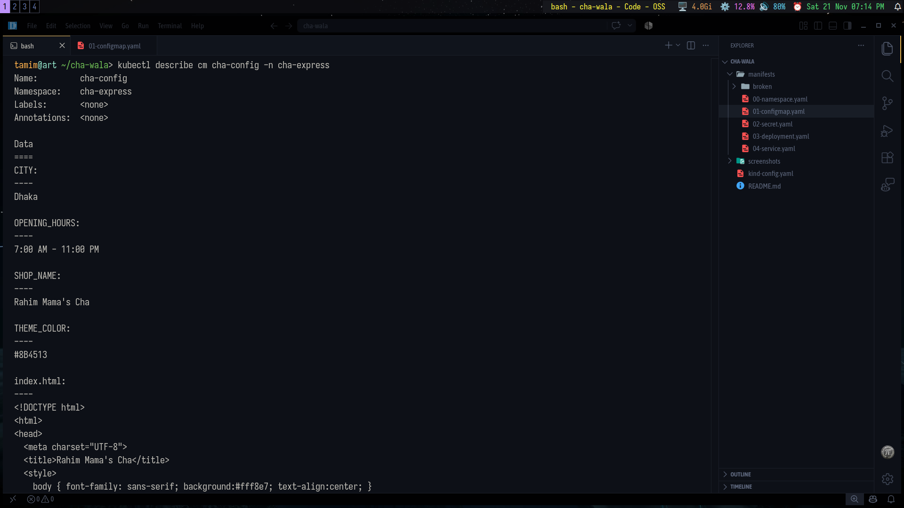

---

## Task 2: ConfigMap

`manifests/01-configmap.yaml` creates `cha-config` with the keys `SHOP_NAME`, `CITY`, `THEME_COLOR`, `OPENING_HOURS` and an `index.html` showing the shop name and five tea/snack items with prices.

```bash
kubectl apply -f manifests/01-configmap.yaml
kubectl get cm cha-config -n cha-express
kubectl describe cm cha-config -n cha-express
```

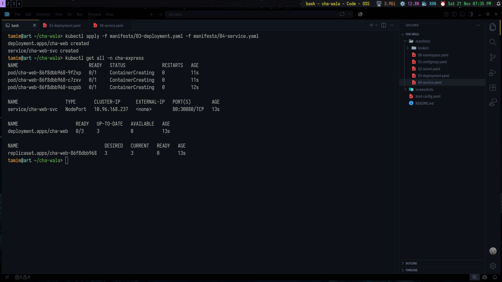

---

## Task 3: Secret

`manifests/02-secret.yaml` creates `cha-secret` with `ADMIN_PASSWORD` and `PAYMENT_API_KEY` (dummy values).

```bash
kubectl apply -f manifests/02-secret.yaml
kubectl get secret cha-secret -n cha-express
```

### Question: Are Kubernetes Secrets encrypted?

**No, not by default.** Secrets are only **base64-encoded**, which is an encoding and not encryption. Anyone who can read the Secret object can decode it, and by default the data is stored in **plaintext in etcd**.

**Proof 1: base64 decodes instantly**

```bash
kubectl get secret cha-secret -n cha-express -o yaml
kubectl get secret cha-secret -n cha-express -o jsonpath='{.data.ADMIN_PASSWORD}' | base64 -d
```

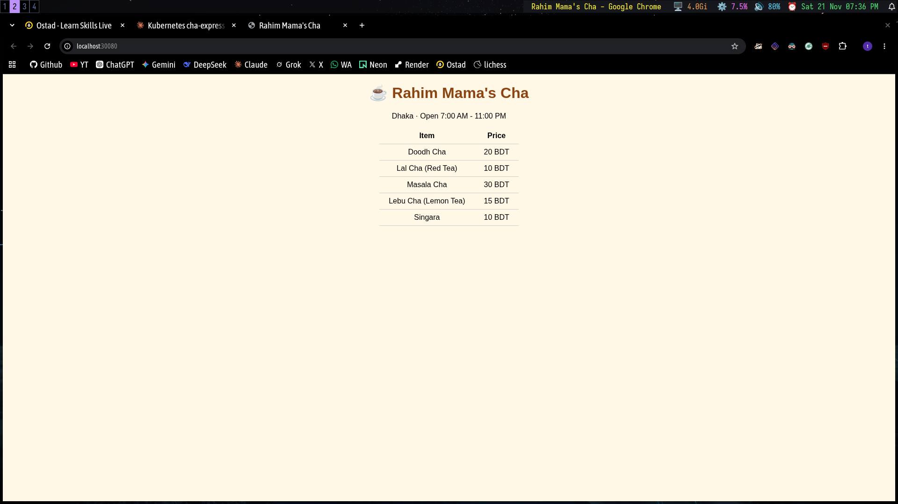

**Proof 2: plaintext in etcd**

```bash
kubectl -n kube-system exec etcd-cha-control-plane -- etcdctl \
  --cacert=/etc/kubernetes/pki/etcd/ca.crt \
  --cert=/etc/kubernetes/pki/etcd/server.crt \
  --key=/etc/kubernetes/pki/etcd/server.key \
  get /registry/secrets/cha-express/cha-secret | cat -v
```

The raw etcd value contains the secret text in readable form and has no `k8s:enc:` prefix (which would indicate encryption at rest).


**To actually protect Secrets:** enable encryption at rest (`EncryptionConfiguration` on the API server, or a KMS provider), restrict access with RBAC, and never commit real secrets to Git.

---

## Task 4: Deployment & Service

`manifests/03-deployment.yaml`:

- Image `nginx:1.25-alpine`, **3 replicas**
- `envFrom` the ConfigMap `cha-config` → all key-value pairs become env vars
- `env` with `secretKeyRef` → **only** `ADMIN_PASSWORD` from `cha-secret`
- ConfigMap `index.html` mounted into `/usr/share/nginx/html` as the default page (mounted as a directory, without `subPath`, so ConfigMap updates propagate)
- Resource requests (`50m` CPU / `32Mi`) and limits (`200m` CPU / `64Mi`)
- Readiness probe on `/`

`manifests/04-service.yaml`: NodePort Service, port `80` → targetPort `80`, **nodePort `30080`**.

```bash
kubectl apply -f manifests/03-deployment.yaml -f manifests/04-service.yaml
kubectl get all -n cha-express
```


### Mama's menu in the browser (`http://localhost:30080`)


### Proof: environment variables inside the container

```bash
POD=$(kubectl get pod -n cha-express -l app=cha-web -o jsonpath='{.items[0].metadata.name}')
kubectl exec -n cha-express $POD -- env | grep -E 'SHOP_NAME|CITY|THEME_COLOR|OPENING_HOURS|ADMIN_PASSWORD'
kubectl exec -n cha-express $POD -- env | grep PAYMENT_API_KEY || echo "PAYMENT_API_KEY not present"
```

All four ConfigMap variables and `ADMIN_PASSWORD` are present, and `PAYMENT_API_KEY` is absent, as required.


---

## Task 5: GitHub Copilot

### Prompt given to Copilot

```
<!-- I USED CLAUDE -->
```

## Task 6: Rolling Update & Rollback

### 6.1 Update to `nginx:1.27-alpine`

```bash
kubectl set image deployment/cha-web nginx=nginx:1.27-alpine -n cha-express
kubectl annotate deployment/cha-web -n cha-express kubernetes.io/change-cause="Upgrade nginx 1.25 -> 1.27" --overwrite
kubectl rollout status deployment/cha-web -n cha-express
```

Update in progress (old pods terminating, new pods starting):

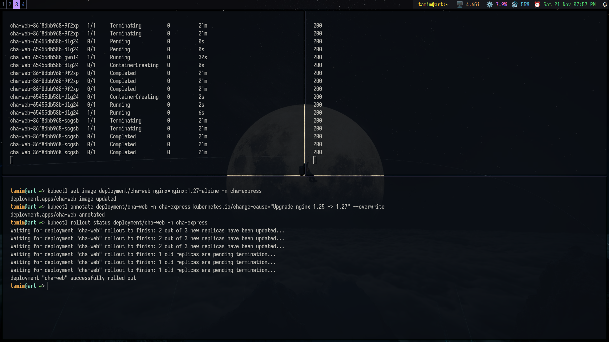

### 6.2 Invalid image tag

```bash
kubectl set image deployment/cha-web nginx=nginx:9.99-doesnotexist -n cha-express
kubectl annotate deployment/cha-web -n cha-express kubernetes.io/change-cause="Bad image tag test" --overwrite
kubectl get pods -n cha-express
```

The new pod gets stuck in `ErrImagePull` / `ImagePullBackOff`, while the old pods keep running.

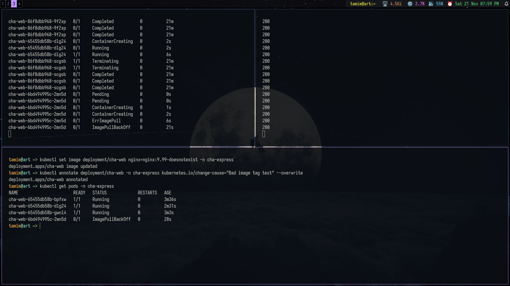

### 6.3 Rollback

```bash
kubectl rollout undo deployment/cha-web -n cha-express
kubectl annotate deployment/cha-web -n cha-express kubernetes.io/change-cause="Rollback to nginx 1.27 (working)" --overwrite
kubectl rollout status deployment/cha-web -n cha-express
```

### 6.4 Rollout history (with change-cause)

```bash
kubectl rollout history deployment/cha-web -n cha-express
```

The reason for each revision is recorded using the `kubernetes.io/change-cause` annotation (the `--record` flag is deprecated).

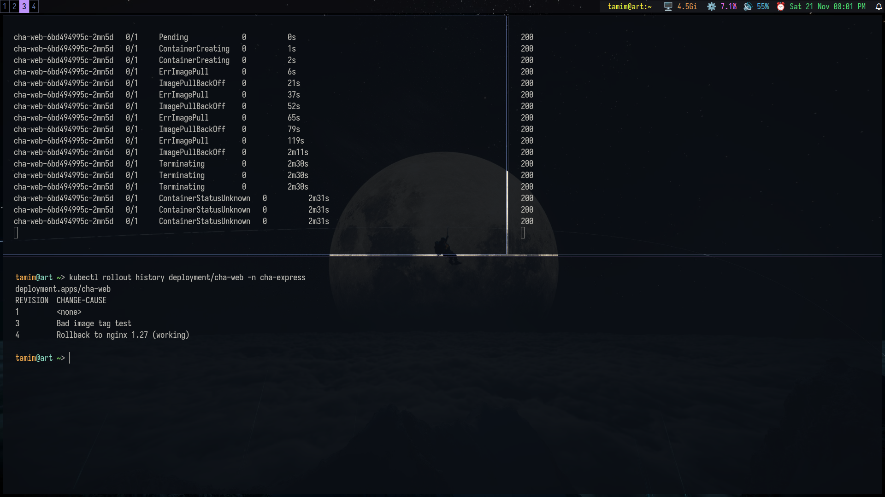

### Question: Did the website go down during the update?

**No.** Reasons:

1. The default **RollingUpdate** strategy (`maxSurge: 25%`, `maxUnavailable: 25%`) creates new pods **before** removing old ones, so there are always running pods.
2. The **readiness probe** means a new pod only receives traffic from the Service once it is Ready.
3. With the **invalid image**, the new pod never becomes Ready, so the rollout stalls and the old working pods keep serving traffic; nothing is taken down.

I verified this by running a `curl` loop against `http://localhost:30080` during the update; it returned `200` throughout.


---

## Task 7: Debug Challenge ("The Shop Is Closed!")

```bash
kubectl apply -f manifests/broken/cha-broken.yaml
kubectl get pods -n cha-express
kubectl describe pod <pod-name> -n cha-express
kubectl get events -n cha-express --sort-by=.lastTimestamp
kubectl get endpoints cha-broken-svc -n cha-express
```

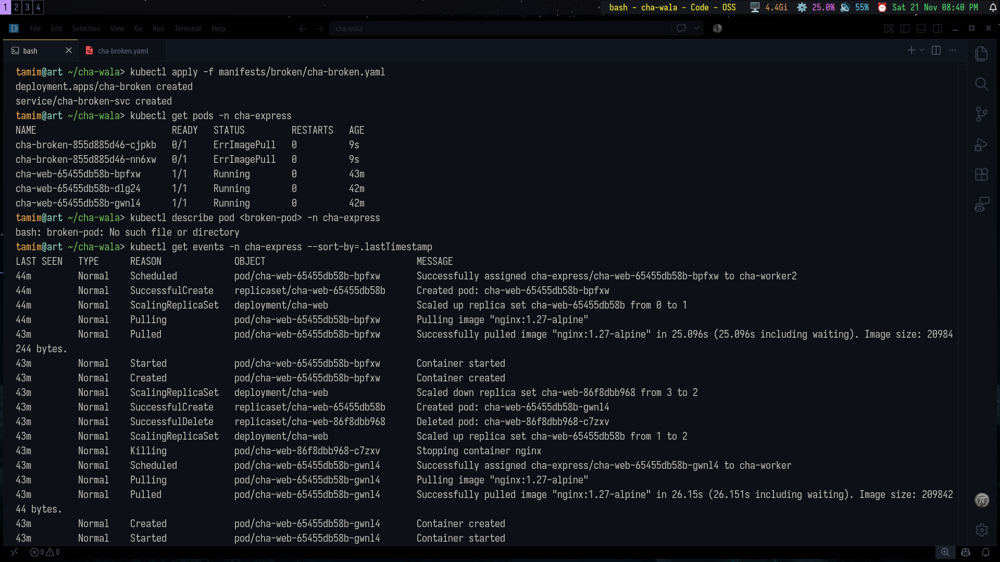

### Bug 1: Typo in image tag (`nginx:1.27-alpinee`)

| | |
|---|---|
| **Symptom** | Pods stuck in `ErrImagePull` / `ImagePullBackOff` |
| **How identified** | `kubectl get pods`, then `kubectl describe pod`: Events show the image/tag could not be pulled (manifest not found) |
| **Root cause** | The tag `1.27-alpinee` does not exist (extra `e`) |
| **Fix** | Changed to `nginx:1.27-alpine` |


### Bug 2: Wrong ConfigMap name (`cha-confg`)

| | |
|---|---|
| **Symptom** | After fixing Bug 1, pods stuck in `CreateContainerConfigError` |
| **How identified** | `kubectl describe pod`: event says ConfigMap `cha-confg` not found |
| **Root cause** | `envFrom.configMapRef.name` is misspelled; the real ConfigMap is `cha-config` |
| **Fix** | Changed to `cha-config` |


### Bug 3: Service selector mismatch (`app: cha-brokn`)

| | |
|---|---|
| **Symptom** | Pods are `Running` but the Service cannot reach them |
| **How identified** | `kubectl get endpoints cha-broken-svc -n cha-express` shows `<none>`; compared `kubectl get pods --show-labels` with the Service selector |
| **Root cause** | Selector `app: cha-brokn` doesn't match the pod label `app: cha-broken`, so the Service has no backends |
| **Fix** | Changed selector to `app: cha-broken` |


### Bug 4: Wrong targetPort (`8080`)

| | |
|---|---|
| **Symptom** | Endpoints exist, but requests through the Service fail (connection refused) |
| **How identified** | `kubectl port-forward svc/cha-broken-svc 8081:80 -n cha-express` then `curl localhost:8081` failed; confirmed nginx listens on port 80 |
| **Root cause** | The Service forwards to port `8080`, but nginx listens on `80` |
| **Fix** | Changed `targetPort` to `80` |


### Verification after fixes

```bash
kubectl apply -f manifests/broken/cha-fixed.yaml
kubectl get pods,svc,endpoints -n cha-express
kubectl port-forward svc/cha-broken-svc 8081:80 -n cha-express &
curl localhost:8081
```

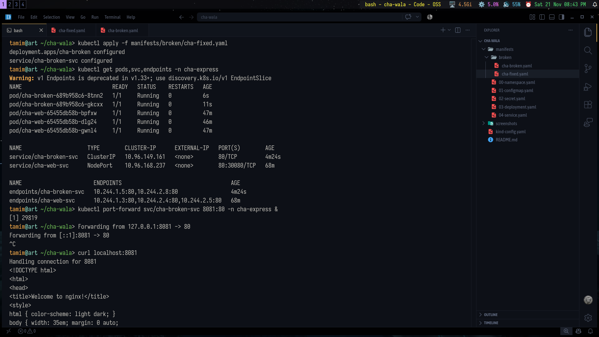

---

## Bonus: ConfigMap Updates

I changed both `THEME_COLOR` and `index.html` in `cha-config`, then waited about a minute.

```bash
kubectl apply -f manifests/01-configmap.yaml
kubectl exec -n cha-express $POD -- env | grep THEME_COLOR
kubectl exec -n cha-express $POD -- cat /usr/share/nginx/html/index.html
curl localhost:30080
```

| What changed | Visible in running pods? |
|--------------|--------------------------|
| `index.html` (mounted volume) | **Yes**, updated automatically |
| `THEME_COLOR` (env var) | **No**, still the old value |

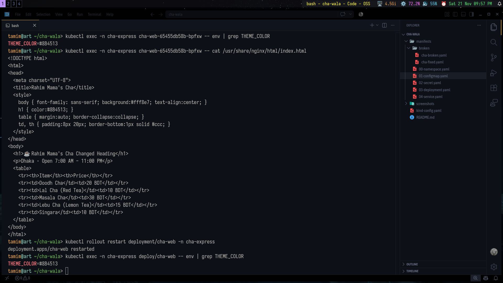

### Question: Why do the two behave differently? What must you do to apply all changes?

- **Environment variables** are read once, when the container process starts. A running process's environment cannot be modified, so the pod keeps the old value.
- **ConfigMap volumes** are refreshed by the kubelet periodically (typically within about a minute) by atomically swapping the projected files. Nginx reads the file from disk on each request, so it serves the new page. (Note: mounts using `subPath` never receive updates, which is why the file is mounted as a directory.)

**To apply all changes**, restart the pods so they start with the new environment:

```bash
kubectl rollout restart deployment/cha-web -n cha-express
kubectl exec -n cha-express deploy/cha-web -- env | grep THEME_COLOR
```


---

## Cleanup

```bash
kind delete cluster --name cha
```